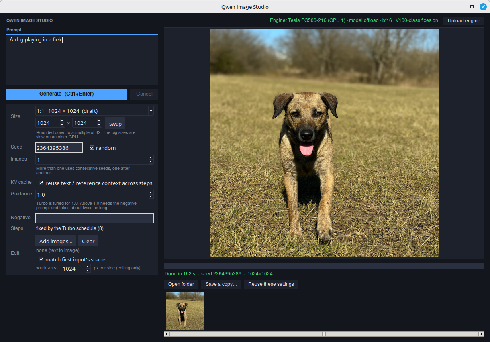

# Qwen Image Studio

A desktop front end for the Qwen-Image-2.1-Turbo image model. It opens a window, loads the model engine in the background, and gives you a prompt box, the pipeline's real options, a live preview and a session gallery. Every image is saved as a PNG with its settings embedded, so "Reuse these settings" can bring any past image back.

## What you can do

- Text-to-image with size presets or custom dimensions, a seed (random or fixed), and several images in a row on consecutive seeds
- Image editing: add one or more input images and describe the change
- Guidance and a negative prompt (the Turbo schedule is tuned for guidance 1.0; higher values are slower)
- KV-cache reuse across steps
- Unload the engine from the window to free GPU memory

## Requirements

- Linux with an NVIDIA GPU
- Python environment with `torch` and `diffusers`, plus Tkinter
- The model, `Qwen/Qwen-Image-2.1-Turbo`, downloaded from Hugging Face on first use or pointed to with `--model`

## Run

Use the Python from the environment that has torch and diffusers:

    ~/qwen-image-env/bin/python qwen_studio.py

Options:

    --gpu auto|0|1        which card to use (default auto = the one with the most VRAM)
    --offload model|sequential|none
                          model       one model part on the GPU at a time (default)
                          sequential  layer by layer, very slow, needs little VRAM
                          none        everything on the GPU (needs the VRAM)
    --dtype bf16|fp16     weight precision (default bf16)
    --compat auto|on|off  workarounds for pre-Ampere cards such as the V100:
                          plain attention, VAE in 32-bit (default auto)
    --out DIR             where images are saved (default: "output" next to the script;
                          studio.log lives next to the script too)
    --model ID_OR_PATH    default Qwen/Qwen-Image-2.1-Turbo
    --no-autoload         open the window without loading the model

## Notes

- If `/mnt/models/.hf` exists and `HF_HOME` is not set, the script uses it as the Hugging Face cache. Change that path near the top of `qwen_studio.py` or set `HF_HOME` yourself.
- Generated images and the log are not part of this repo.

## License

MIT. See [LICENSE](LICENSE).
